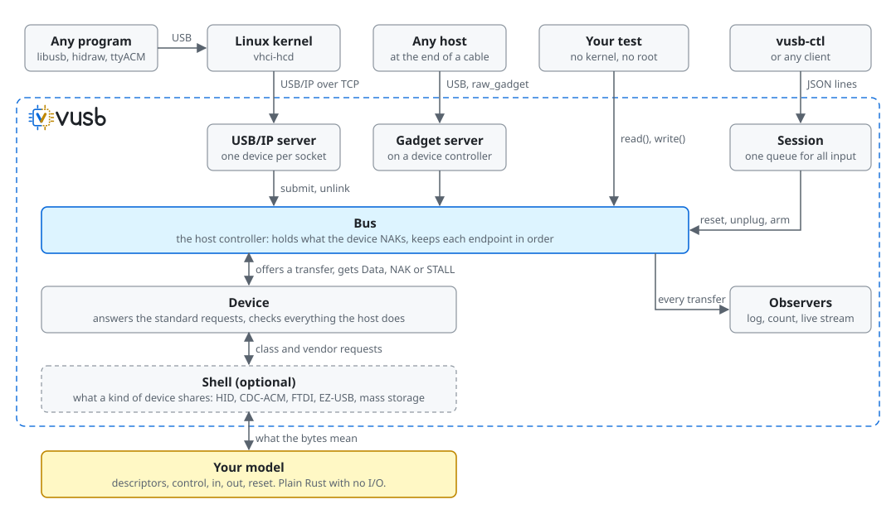
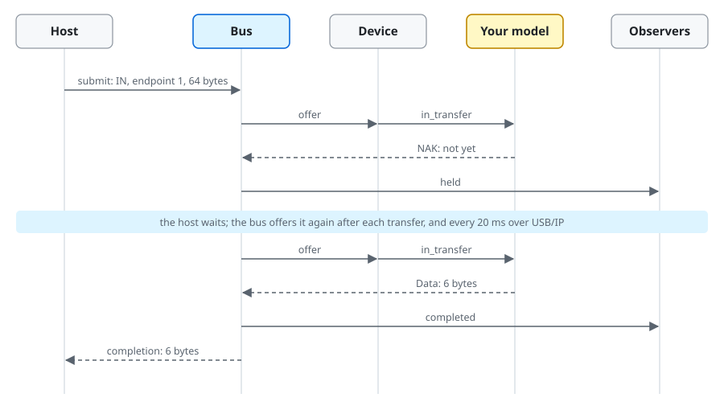

# The design of vusb

## How the parts fit

A program or a test reaches your device model through the same bus and device
layers. You write the yellow box. vusb is everything inside the dashed line.

- **Bus** is the host controller. Tests and transports all drive it.
- **Device** answers the standard requests every USB device must, and checks what
  the host does.
- **Shells** carry what every device of a kind shares: HID, CDC-ACM, FTDI, EZ-USB.
- **Your model** says what the device means. It implements `DeviceModel`, or a
  shell's smaller trait.
- **Observers** see every transfer, to keep a log, count violations or stream live.
- **Transports** carry the bus to a host: USB/IP to Linux's `vhci-hcd`, so the
  device is on the machine, or usbredir to
  [QEMU](https://github.com/oxrok/vusb/blob/main/docs/qemu.md), so it is inside
  a guest. Both are codecs around the same `Bus`.
- **Session** serves a model and attaches it, and takes commands through the
  [control protocol](https://github.com/oxrok/vusb/blob/main/docs/control.md).

## The life of a transfer

The idea to hold on to: **a model never waits**. Asked for data it does not have,
it answers NAK and returns. The bus holds the transfer and asks again, as a real
host controller does.

Four design choices follow from that:

- **Models have no I/O, threads or clocks.** They are plain state machines, so
  they are easy to write and run the same everywhere. A model that needs time
  counts the host's offers, so a run does not depend on how fast the machine is.
- **There is one bus.** Tests and transports all drive the same `Bus`, so a device
  that passes in a unit test behaves the same way for the kernel.
- **Checking is built in.** `Device` flags what breaks USB, and a model flags what
  breaks its own protocol. `vusb run` exits with status 2 if the host did either.
- **Faults are counted, not timed.** `arm` fires on the Nth transfer of an
  endpoint, so the same failure happens at the same point on every run.
