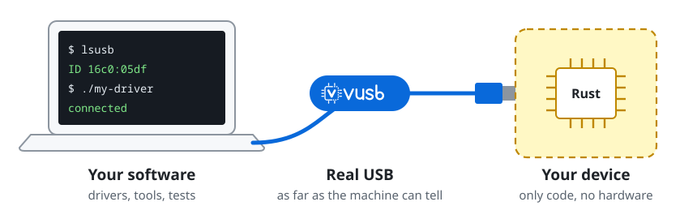

<p align="center"></p>

<p align="center">
<a href="https://crates.io/crates/vusb"></a>
<a href="https://docs.rs/vusb"></a>
<a href="https://github.com/oxrok/vusb/actions/workflows/ci.yml"></a>
</p>

vusb puts a USB device on the bus that is only Rust code. Test your driver
without the hardware, in CI, and with fault injection.



On Linux the device is real to the whole machine: `lsusb` lists it, and libusb,
hidraw, `/dev/ttyACM0` and `/dev/ttyUSB0` all work. In a unit test it needs no
kernel and no root. Either way it is the same code, and it reports every time
the host breaks the protocol.

## Try it

This puts an example relay board on your machine, on Linux:

```sh
cargo install vusb-cli
sudo modprobe vhci-hcd
sudo vusb run hid-relay --attach --open-devices --control /tmp/relay.sock
```

Then, from another terminal and without root:

```sh
export VUSB_CONTROL=/tmp/relay.sock

# It is there.
lsusb -d 16c0:05df

# Watch what the host does.
vusb-ctl subscribe tx violations --lines &

# Pull the cable at the third control read, which lsusb -v causes.
vusb-ctl arm event=unplug when=in=0:3
lsusb -v -d 16c0:05df >/dev/null

# Plug it back.
vusb-ctl replug
vusb-ctl quit
```

## Write a device

This serial port answers in capitals. The CDC-ACM shell handles the USB side, so
the model only sees bytes:

```rust
use vusb::bus::Bus;
use vusb::device::Device;
use vusb::host::enumerate;
use vusb::shells::cdc::{Cdc, Faults, Identity, Port, Serial};

struct Shout;

impl Serial for Shout {
    fn received(&mut self, data: &[u8], port: &mut Port<'_>) {
        port.send(&data.to_ascii_uppercase());
    }
}

fn main() -> vusb::Result<()> {
    let id = Identity::new(0x1209, 0x0001, "Maker", "Shouter");
    let model = Cdc::new("shout", &id, Faults::default(), Shout);

    // A test: no kernel involved.
    let mut bus = Bus::new(Device::new(Box::new(model)));
    enumerate(&mut bus)?;
    bus.write(2, b"hello");
    assert_eq!(bus.read(2, 64).data, b"HELLO");
    Ok(())
}
```

To put a model on the machine instead, hand it to a session:

```rust,no_run
use vusb::control::Address;
use vusb::examples::cdc_echo;
use vusb::session::Builder;

fn main() -> vusb::Result<()> {
    let report = Builder::new(Box::new(|options| cdc_echo::build(options)))
        .attach(true)
        .control(Address::parse("/tmp/echo.sock"))
        .start()?
        .run()?;
    println!("violations: {}", report.violations);
    Ok(())
}
```

Without a shell, a model implements `DeviceModel` directly. The
[`examples`](https://github.com/oxrok/vusb/tree/main/vusb/src/examples) module
has a short model on each kind of shell, and the API is documented on
[docs.rs](https://docs.rs/vusb).

## How it works

A model never waits. Asked for data it does not have, it answers NAK and returns,
and vusb holds the transfer and asks again, as a real host controller does. So a
model is a plain state machine, and the same one runs in a test and on the machine.

See [the design](https://github.com/oxrok/vusb/blob/main/docs/design.md), with
diagrams of how the parts fit and the life of a transfer.

## Control a running device

Every session can take commands on a socket: `vusb-ctl` from a shell, or JSON lines
from any language. Reset the device, change its options, pull the cable, inject
faults, and stream every transfer live. Programs can add commands of their own.

See the [control protocol](https://github.com/oxrok/vusb/blob/main/docs/control.md).

## Limits

- Attaching a device to the machine needs Linux, root and `vhci-hcd`. A QEMU
  guest takes one on any platform, with no root: see
  [QEMU](https://github.com/oxrok/vusb/blob/main/docs/qemu.md). Models and
  tests run on Linux, macOS and Windows.
- No hubs or super speed yet.
- The API may change before 1.0.

## Licence

MIT or Apache-2.0, at your option.
